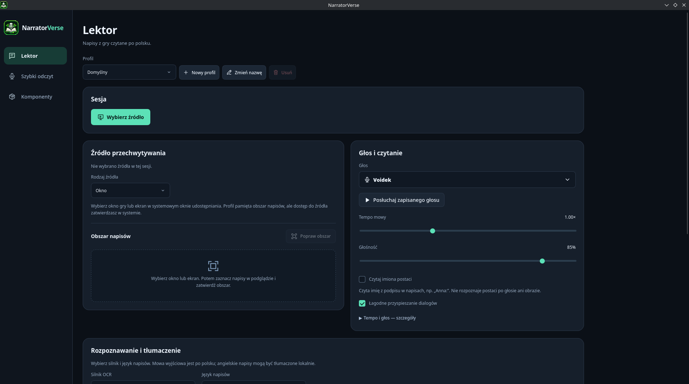

# NarratorVerse

Lektor napisow do gier na Linuksa. Odczytuje wybrany fragment okna lub ekranu
i generuje polska mowe lokalnie, bez modyfikowania plikow gry.
Angielskie napisy tlumaczy na polski przez QuickMT.



## Wymagania

- Linux x86_64 i Flatpak z GNOME Platform 49.
- Portal pulpitu obslugujacy przechwytywanie okna lub ekranu przez PipeWire.
- Wyjscie audio; polaczenie z siecia do pobrania komponentow.

OCR (Tesseract lub RapidOCR), tlumaczenie i synteza Piper dzialaja lokalnie.
GPU ani CUDA nie sa wymagane. Minimalne wymagania CPU i RAM nie sa jeszcze ustalone.

## Instalacja i budowanie

Wersja **0.2.0-beta.1** jest w przygotowaniu. Nie ma jeszcze publicznego Flatpaka
tej wersji. Instrukcje: [instalacja](docs/INSTALL.md) i [fresh-build](docs/FRESH_BUILD.md).

Budowa wymaga przypietych SDK, narzedzi hosta oraz oryginalnych plikow glosu
Voidek w osobnym katalogu. Uruchom z katalogu repozytorium:

```sh
bash scripts/build-fresh.sh /absolute/new/work-directory /absolute/voice-input
```

Katalog roboczy nie moze istniec. Skrypt buduje lokalnego kandydata;
nie eksportuje, nie instaluje ani nie publikuje pakietu.

## Uzywanie

W panelu Komponenty sprawdz OCR i glos. Dla angielskich napisow pobierz QuickMT.
Wybierz profil, jezyk napisow i glos, udostepnij okno gry, zaznacz obszar napisow
i rozpocznij czytanie. Dostepne sa import glosow Piper, regulacja tempa,
przyciszanie gry oraz szybki odczyt wklejonego tekstu.

Weryfikacja powtarzania kwestii w rzeczywistej sesji Arch/GTA nadal jest otwarta.
OCR moze mylic male lub cieniowane napisy. Zmiany i pozostale ograniczenia:
[RELEASE_NOTES](RELEASE_NOTES.md). Przed udostepnieniem logow sprawdz ich tresc;
moga zawierac napisy z gry. [Diagnostyka](docs/DIAGNOSTICS.md).

## Testy

```sh
npm ci --no-audit --no-fund
npm run check
npm run test:ui
npm run build
```

Testy backendu: `sh scripts/test.sh` w przygotowanym srodowisku Python/Qt.
Wymagania opisuje [INSTALL](docs/INSTALL.md).

## Licencja i autor

Kod: MIT, [LICENSE](LICENSE). Zaleznosci i modele maja osobne warunki,
opisane w [NOTICE](licenses/NOTICE.md). Voidek nie jest objety MIT.

Autor: **DevVoidPL**.
