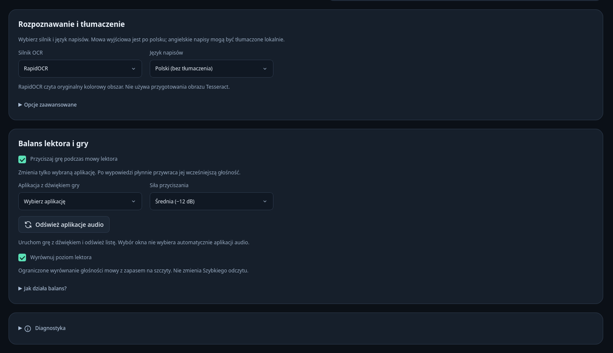
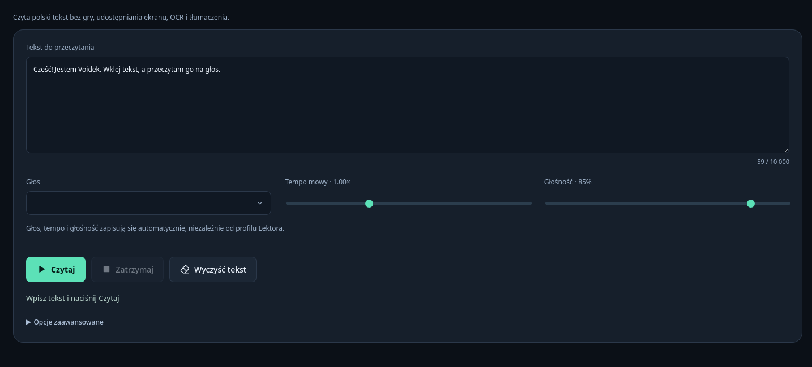

# NarratorVerse

Lektor napisow do gier na Linuksa. Czyta napisy z wybranego fragmentu okna
lub ekranu i odtwarza je po polsku. Nie wymaga modyfikowania plikow gry.

## Podglad


<details>
<summary>Rozpoznawanie napisow i balans dzwieku</summary>



</details>

<details>
<summary>Szybki odczyt tekstu</summary>



</details>

## Funkcje

- Odczyt polskich napisow i lokalne tlumaczenie angielskich napisow na polski.
- Wybor silnika OCR: Tesseract lub RapidOCR.
- Glos Voidek oraz import wlasnych glosow Piper z plikow `.onnx` i `.onnx.json`.
- Regulacja tempa, glosnosci i lagodne przyspieszanie szybkich dialogow.
- Opcjonalne czytanie imion postaci z podpisow, np. `Anna:`.
- Przyciszanie wybranej gry podczas mowy lektora.
- Osobne profile dla roznych ustawien i obszarow napisow.
- Szybki odczyt wklejonego tekstu, bez gry i udostepniania ekranu.

Interfejs jest po polsku. Obslugiwane tryby napisow to polski bez tlumaczenia
oraz angielski z tlumaczeniem na polski. Import glosu nie dodaje nowych trybow
tlumaczenia. Program nie rozpoznaje postaci po twarzy ani po ich glosie.

## Uzywanie

1. Wybierz lub utworz profil w Lektorze.
2. Ustaw rodzaj zrodla, silnik OCR, jezyk napisow, glos i tempo.
3. Zapisz zmiany.
4. Kliknij **Wybierz zrodlo** i wskaz okno gry albo ekran w oknie systemowym.
5. Zaznacz same napisy w podgladzie i zatwierdz obszar.
6. Rozpocznij czytanie.

Pauza wstrzymuje czytanie bez zamykania udostepniania. Zatrzymanie zamyka
przechwytywanie i pozwala zmienic ustawienia profilu. Dostep do okna zalezy od
systemowego portalu; zapis profilu nie gwarantuje zachowania zgody po restarcie.

Opcje czytania sa w Lektorze. Klikniecie nazwy glosu otwiera wybor i import
nowego glosu. Przy imporcie zaznacz razem model i pasujacy plik konfiguracji
(Ctrl + klikniecie). Diagnostyka jest zwinieta na dole strony.

### Profile

Ustawienia Lektora zapisuja sie przyciskiem **Zapisz zmiany**. Formularz pokazuje
niezapisane zmiany, a przejscie do innego profilu wymaga ich odrzucenia.
Zamkniecie aplikacji bez zapisu nie zachowuje edytowanego formularza.

Profil pamieta m.in. obszar napisow, silnik OCR, jezyk, glos, tempo i aplikacje
audio. Przywrocenie domyslnych ustawien wymaga potwierdzenia i zapisuje sie
od razu; nie usuwa modeli ani wlasnych glosow.

Szybki odczyt ma osobne opcje glosu, tempa i glosnosci, zapisywane automatycznie.
Czyta do 10 000 znakow polskiego tekstu. Nie uruchamia OCR ani tlumaczenia.

### Balans gry

Uruchom gre z dzwiekiem, odswiez liste aplikacji audio i wybierz wlasciwa
aplikacje. Wlacz przyciszanie i zapisz profil. Wybor okna przechwytywania nie
wybiera automatycznie aplikacji audio.

Poziomy przyciszania to -6, -12 i -18 dB. Po mowie lektora wraca poprzednia
glosnosc gry, nie 100%. Program nie zmienia glosnosci glownej, wyciszenia ani
trasowania. Nie oddziela dialogow gry od muzyki. Reczna regulacja w mikserze
oddaje Ci sterowanie do ponownego wlaczenia czytania.

Funkcja wymaga lokalnego PipeWire z interfejsem PulseAudio, narzedzia `pactl`
i metadanych pozwalajacych rozpoznac strumien. Zmiana strumienia moze wstrzymac
balans; sprawdz wtedy poziom gry i wznow czytanie. Osobny proces i dziennik
pomagaja przywrocic glosnosc po utracie polaczenia z silnikiem. Nie gwarantuja
przywrocenia po smierci obu procesow, zmianie tozsamosci strumienia lub zaniku
zasilania.

Wyrownanie poziomu lektora ma ograniczone wzmocnienie i chroni przed
przesterowaniem. Nie analizuje glosnosci gry ani nie dotyczy Szybkiego odczytu.

## Ograniczenia

Jakosc OCR zalezy od czcionki, tla, rozdzielczosci i zaznaczenia napisow.
Nie kazda kwestia zostanie odczytana poprawnie. Dwa identyczne napisy wymagaja
widocznej granicy, np. znikniecia lub zmiany. Program nie ma dostepu do skryptu
dialogow gry ani listy nazw postaci.

Tempo bazowe ma zakres 0,5-2x. Adaptacja zmienia tempo nowych wypowiedzi,
maksymalnie do 150% tempa bazowego i nie ponad 2x. Nie zmienia trwajacej mowy.
Przy dlugim, szybkim dialogu kolejka moze pominac czesc oczekujacych kwestii.

Przetwarzanie obrazu, tlumaczenie i mowa sa lokalne. Siec jest potrzebna do
pobierania komponentow, nie do wysylania obrazu gry do uslugi zewnetrznej.
Przed udostepnieniem diagnostyki sprawdz jej tresc: moze zawierac napisy z gry,
nazwy aplikacji, urzadzen oraz lokalne sciezki.

## Kod i budowa

Interfejs korzysta z Svelte i TypeScript, aplikacja okienkowa z Tauri 2,
a osobny proces Python/Qt zajmuje sie przechwytywaniem i przetwarzaniem napisow.
Wersje zaleznosci interfejsu i Rust sa zapisane w plikach blokad.

Repozytorium zrodlowe nie zawiera modeli ani lokalnego srodowiska wykonawczego.
Obecne skrypty budowania pakietu korzystaja z przygotowanych katalogow
`.runtime` i `components`. Pelna, odtwarzalna budowa tych zaleznosci od zera
nie jest jeszcze przygotowana. Samo sklonowanie kodu nie wystarczy do
zbudowania kompletnego Flatpaka.

Do sprawdzenia i zbudowania interfejsu wystarczy Node.js z npm. W przygotowanym
srodowisku uzywany jest Node 22.22.0. Polecenia uruchamiaj z katalogu projektu:

```sh
sh -eu -c '
  npm ci --no-audit --no-fund
  npm run check
  npm run build
'
```

Budowa aplikacji wymaga ponadto GNOME SDK/Platform 49 i rozszerzenia
Rust SDK 25.08. Po przygotowaniu srodowiska:

```sh
sh scripts/build.sh
```

Samo pakowanie gotowego pliku wykonywalnego:

```sh
sh scripts/build-flatpak.sh
```

Instalacja lokalnego pakietu (wczesniej zamknij aplikacje):

```sh
flatpak install --user --reinstall --bundle flatpak/artifacts/NarratorVerse-0.1.0-x86_64.flatpak
```

Pakowanie odmawia nadpisania istniejacego katalogu budowania. Lokalny,
niepodpisany pakiet i suma SHA-256 trafiaja do katalogu artefaktow Flatpaka.
Nie jest to jeszcze pakiet po pelnym audycie redystrybucji.

## Licencje

Kod aplikacji jest na licencji MIT. Zaleznosci i modele maja wlasne warunki.
Glos Voidek nie jest objety MIT; niezmieniony model moze byc dolaczany do
pakietow NarratorVerse na podstawie zgody wlasciciela. Tresc licencji i zakres
zezwolenia sa zachowane w dokumentacji licencyjnej.

Informacje o pochodzeniu kodu, zaleznosciach i ograniczeniach redystrybucji
sa w katalogu licencji. Lokalny pakiet korzysta z kopii srodowiska wykonawczego,
a audyt licencji i obowiazkow dotyczacych zrodel zaleznosci nie jest zakonczony.
Wlasne glosy, profile i dane uzytkownika nie sa czescia publikowanych zrodel.